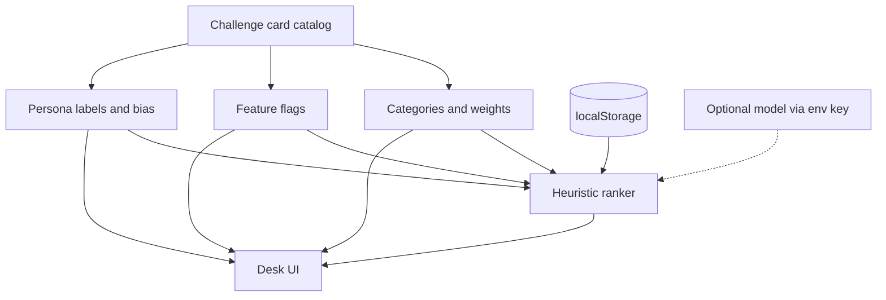

# Architecture

Pivot-proof Deadline Copilot keeps the hackathon’s mid-build twists in data. A Challenge Card can rename the persona, toggle features, and retarget the use case. The React tree reads one resolved card. It does not grow a branch per persona.

`resolveChallenge(activeCardId)` is the only lookup. From that object the UI takes:

- `persona.labels` for every persona noun (desk name, “what next”, task, due, impact, empty copy)
- `flags` to mount or hide energy, blockers, streak, timeboxing, team view, and the model button
- `useCase.categories` for the create form
- `useCase.weights` and `useCase.horizonHours` for the score
- `persona.bias` for a small category or blocked-work nudge
- `accent`, `voice`, and `samples` for the ticket and the sample board

There is no `if (cardId === "…")` in the components. Active state compares a button’s own id with the resolved card. That is selection, not a persona fork.

## Layers

| Layer | Where | Pivot behavior |
|---|---|---|
| Catalog | `src/lib/challenge/cards.ts` | Plain objects. A new card is a new object. |
| Resolve | `src/lib/challenge/resolve.ts` | Id to card, category label, sample tasks. |
| Ranker | `src/lib/prioritize/heuristic.ts` | Weighted sum. Always runs in the browser. |
| Model overlay | `src/app/api/rank/route.ts` | Optional. Missing key or a failed call returns the heuristic. |
| Persistence | `src/lib/storage.ts`, `src/lib/board-store.ts` | `localStorage`. Survives a Vercel deploy because nothing is written to the server disk. |
| UI | `src/components/*` | One board. Flags and labels decide what is on screen. |

## Task shape

A task is use-case agnostic: `title`, `dueAt`, `impact`, `effort`, `energy`, `category`, `blockedBy`, `owner`, `done`. Category is a string. When a card’s category list changes, old tasks keep their stored category and still rank; the form only offers the active card’s categories.

`App` state in the same storage record is the active card id plus the last ranker note, method, and optional model order.

## Ranker

Open tasks only. Each one scores:

`urgency + impact + effort-fit + energy + unblock + persona bias`

- Urgency rises as the due time approaches the card’s horizon, and caps when the task is overdue.
- Impact is the 1–5 mark, normalized.
- Effort-fit prefers work that can finish inside the time left.
- Energy scores only when `flags.energy` is on, and prefers a lower drain.
- Unblock scores only when `flags.blockers` is on, and prefers blocked work.
- Bias adds the card’s category boost, plus `blockedBoost` when blockers are on and the task is blocked.

The use case supplies the weights. Turning a flag off forces that term to zero even if a weight was left in the object. The desk shows the weights, so a flip is visible before you read the new order.

The model path is a second opinion. `POST /api/rank` resolves the same card, recomputes the heuristic, and, when `flags.llmPrioritize` is on and `AI_GATEWAY_API_KEY` or `OPENAI_API_KEY` is set, asks the Vercel AI SDK for an ordered id list (`generateText` + `Output.object`). Unknown ids are dropped. Any error, empty output, or missing key responds with the heuristic and a sentence the UI prints. Gateway wins if both keys are set. `AI_MODEL` overrides the default (`openai/gpt-5.4-mini` on the gateway, `gpt-5.4-mini` directly).

## Why localStorage

The desk is single-user. A SQLite file on disk does not survive Vercel’s serverless instances, and a hosted database needs credentials this demo does not require. `localStorage` is on every public deploy, keeps the board across refresh, and fails in a way the UI can say out loud (blocked storage, unreadable JSON). The cost is that the board does not follow the user to another browser.

## How a new Challenge Card is added

1. Append an object to `CARDS` in `src/lib/challenge/cards.ts`.
2. Give it an `id`, ticket copy, `accent`, persona labels, a one-line `biasNote`, category boosts, and a `blockedBoost`.
3. Set `flags`. Features you leave false are hidden and, for energy and blockers, dropped from the score.
4. Set `useCase`: `horizonHours`, `categories`, and `weights`.
5. Add `samples` whose `category` values exist on that card. The module throws at import if one does not.
6. Run `npx tsx scripts/check-rank.ts` if you care about a specific order, then `npm run build`.

No page, route, or board component needs a branch for that card. Flip buttons are rendered from `listCards()`.

## What this design refuses

- A second board component per persona.
- Feature checks written as `if (cardId === "exam-cram")` in JSX.
- A required model. The brief treats the LLM as an overlay.
- Accounts. One person, one browser, one board.
